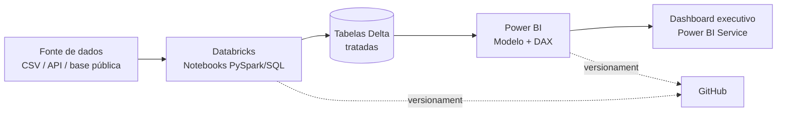

# Projeto End-to-End: Databricks + Power BI — Dashboard Executivo de Vendas

Projeto de Engenharia e Análise de Dados que cobre o caminho completo do dado: **ingestão e tratamento no Databricks (PySpark/SQL)**, **armazenamento em tabelas Delta** e **visualização no Power BI** para apoiar a tomada de decisão comercial.

---

## 📌 Contexto e problema de negócio: Uma empresa de varejo precisa acompanhar o desempenho de vendas, mas os dados brutos chegam em arquivos separados, com inconsistências, e a diretoria não tem uma visão única de receita, margem e desempenho por região e produto.»

**Perguntas que o dashboard responde:**

- Qual é a receita total e como ela evolui mês a mês?
- Quais produtos, categorias e regiões mais contribuem para o resultado?
- Qual é o ticket médio e o volume de pedidos no período?
- Onde estão as maiores quedas ou oportunidades de crescimento?
- «adicione outras perguntas do seu dashboard»

 🏗️ Arquitetura



| Etapa | Ferramenta | O que acontece |
|---|---|---|
| 1. Ingestão | Databricks | Leitura dos dados brutos «descreva o formato: CSV, Excel, API…» |
| 2. Tratamento | PySpark / SQL | Limpeza, padronização de tipos, tratamento de nulos e duplicados, criação de colunas derivadas |
| 3. Armazenamento | Delta Lake | Gravação das tabelas tratadas em formato Delta, prontas para consumo |
| 4. Modelagem | Power BI | Relacionamentos entre tabelas, tabela calendário e medidas em DAX |
| 5. Visualização | Power BI | Dashboard interativo com KPIs, gráficos e filtros |
| 6. Versionamento | GitHub | Notebooks, arquivo .pbix e documentação |

---

## 🧰 Tecnologias utilizadas

- **Databricks** (notebooks, cluster, tabelas Delta)
- **PySpark** e **SQL** para transformação dos dados
- **Delta Lake** como formato das tabelas tratadas
- **Power BI Desktop** (Power Query, modelagem, DAX) e **Power BI Service** (publicação)
- **Git/GitHub** para versionamento

---

## 📂 Estrutura do repositório

```
projeto-databricks-powerbi/
├── notebooks/
│   └── pipeline_vendas.ipynb      # Pipeline de ingestão e tratamento (Databricks)
├── powerbi/
│   └── dashboards_vendas.pbix     # Relatório Power BI
├── docs/
│   └── img/                       # Prints do dashboard
└── README.md
```

---

## 📊 Fonte dos dados

- **Origem:** «nome da base e link. Ex.: Kaggle, dados abertos do governo, base de exemplo…»
- **Período coberto:** «ex.: jan/2023 a dez/2024»
- **Volume:** «ex.: 100 mil linhas, 12 colunas»
- **Licença/observação:** «informe se os dados são públicos, fictícios ou de exemplo»

**Principais colunas:**

| Coluna | Descrição |
|---|---|
| «data_pedido» | Data da venda |
| «produto / categoria» | Item vendido e sua categoria |
| «região / cidade» | Localização da venda |
| «quantidade» | Unidades vendidas |
| «valor / receita» | Valor da venda |
| «adicione as demais» | |

---

## ⚙️ Pipeline de dados (Databricks)

O notebook `pipeline_vendas.ipynb` executa as seguintes etapas:

1. **Leitura** dos dados brutos em um DataFrame Spark.
2. **Padronização**: nomes de colunas, tipos de dados (datas, numéricos) e formatos de texto.
3. **Qualidade dos dados**: remoção de duplicados, tratamento de valores nulos e validação de valores inconsistentes (ex.: quantidades ou valores negativos).
4. **Enriquecimento**: criação de colunas derivadas como ano, mês e «outras que você criou».
5. **Gravação** das tabelas tratadas em formato **Delta** para consumo pelo Power BI.

**Decisões de tratamento:**

- «Ex.: Registros sem data foram removidos por inviabilizarem a análise temporal.»
- «Ex.: Valores nulos de desconto foram preenchidos com 0.»
